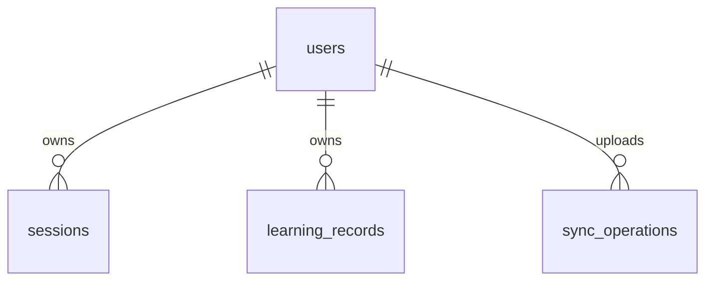

# Database structure

The server stores data in PostgreSQL 16+. `src/db.js` creates a pool using
`DATABASE_URL`, or standard `PGHOST`, `PGPORT`, `PGDATABASE`, `PGUSER`, and
`PGPASSWORD` settings when the URL is absent. See [Deployment](DEPLOYMENT.md)
for connection and TLS settings.

## Tables and relationships

| Table | Key and important columns | Purpose |
| --- | --- | --- |
| `users` | UUID `id`; unique `email`; `password_hash`, `display_name`, `role`, `created_at` | Learner/editor accounts; role is `learner` or `admin` |
| `sessions` | `token_hash`; `user_id` FK; `expires_at`, `created_at` | Revocable bearer sessions, storing hashes only |
| `stories` | Text `id`; `family`, `category`, `difficulty`, `status`, JSONB `content`, JSONB `vocabulary`, timestamps | Translated story variants and their dictionaries |
| `learning_records` | Composite `(user_id,kind,key)`; JSONB `data`, `deleted`, BIGSERIAL `revision`, `updated_at` | Progress, vocabulary, review events, preferences, and deletion tombstones |
| `sync_operations` | Composite `(user_id,operation_id)`; `fingerprint`, `created_at` | Deduplicates uploaded operations and rejects changed retries |
| `auth_attempts` | Hashed email/IP `bucket`; `attempts`, `expires_at` | Shared 15-minute authentication rate limits |
| `schema_migrations` | Migration filename `name`; `applied_at` | Tracks completed SQL upgrades |



Deleting a user cascades to their sessions, learning records, and operation IDs.
Stories have no foreign key to users or learning records. A learning word retains
its story ID, title, category, translations, and examples even if the story is
removed. Review records refer to a vocabulary natural key rather than a server
row ID; deleting a word preserves review statistics.

`content` stores the [story authoring fields](STORIES.md) excluding vocabulary.
`vocabulary` is an array of multilingual dictionary objects. Paragraph
translations line up by array index, and dictionary entries are identified by
language and normalized word. PostgreSQL enforces difficulty/publication values;
Zod additionally checks JSON shapes and complete dictionary coverage.

## Learning JSON

`learning_records.kind` is one of `progress`, `vocabulary`, `review`, `profile`.
Examples of natural keys:

```json
{
  "progress": "reader_a1:en",
  "vocabulary": "en:id:reader_a1:reads",
  "review": "00000000-0000-4000-8000-000000000001",
  "profile": "preferences"
}
```

Vocabulary JSON includes four-state `status`, `statusChangedAt`, the compatible
`mastered` flag, schedule counters, due time, and contextual word details. Review
JSON contains the outcome, rating, timestamp, and `vocabularyKey`. See [API](API.md)
for complete bodies and [Learning system](LEARNING_SYSTEM.md) for their meaning.

Revisions come from a shared sequence but are read per user; gaps are normal.
Writes lock the user's row for the transaction so a sync cursor never skips an
earlier, still-uncommitted write. Each change replaces the record and allocates a
new revision. Progress preserves completed=true across non-deleted replacements.

DELETE keeps the row with `deleted=true,data=null` and a new revision. This lets a
device that was offline learn about removals. Keep tombstones and operation IDs
until a device-expiration policy exists; early pruning can resurrect stale data.

## Migrations and maintenance

```sh
node --env-file=.env scripts/migrate.js
```

`scripts/migrate.js` takes a PostgreSQL advisory lock, applies unapplied `.sql`
files in filename order, and records them in `schema_migrations`, all within a
transaction. Add new numbered migrations; do not edit previously applied SQL.
Run migrations before serving a release. Seeding is separate and idempotent.

The vocabulary status upgrade adds JSON fields, so it needs no PostgreSQL schema
change: new writes are validated, and reads infer missing fields on old records.
Android's separate Room database upgrades from version 1 through 2 to 3 using
explicit migrations. Version 3 adds `status` and `statusChangedAt`, derives old
mastery levels, and preserves schedules, reviews, and queued operations.

Back up PostgreSQL before schema changes. Periodically delete expired `sessions`
and `auth_attempts` rows; retain learning tombstones and `sync_operations`. Indexes
support published catalogs, session lookup/expiry, and per-user revision scans.
Use the content API rather than editing story JSON directly in SQL.
